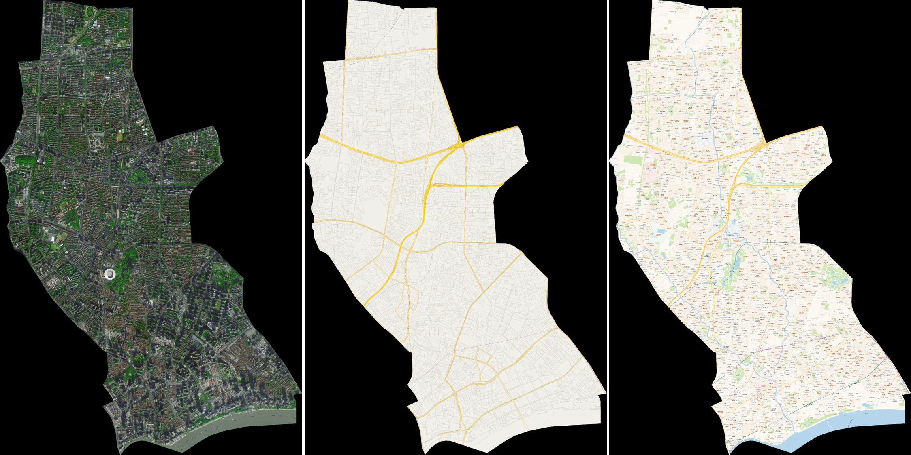
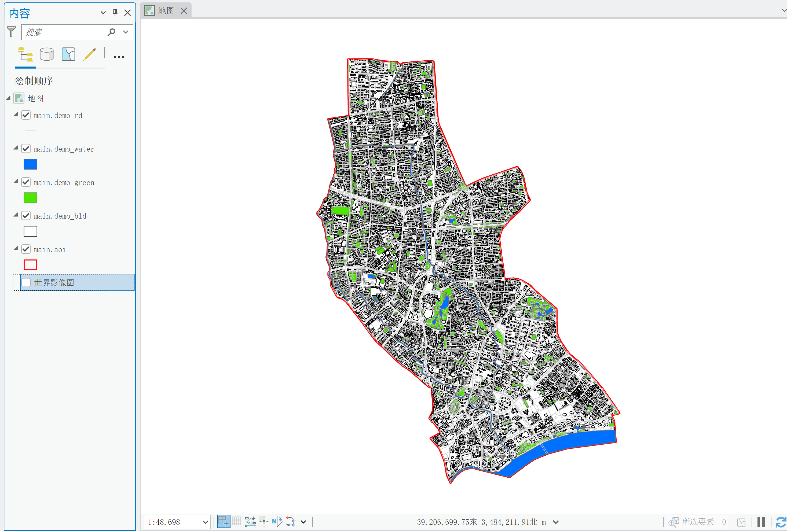
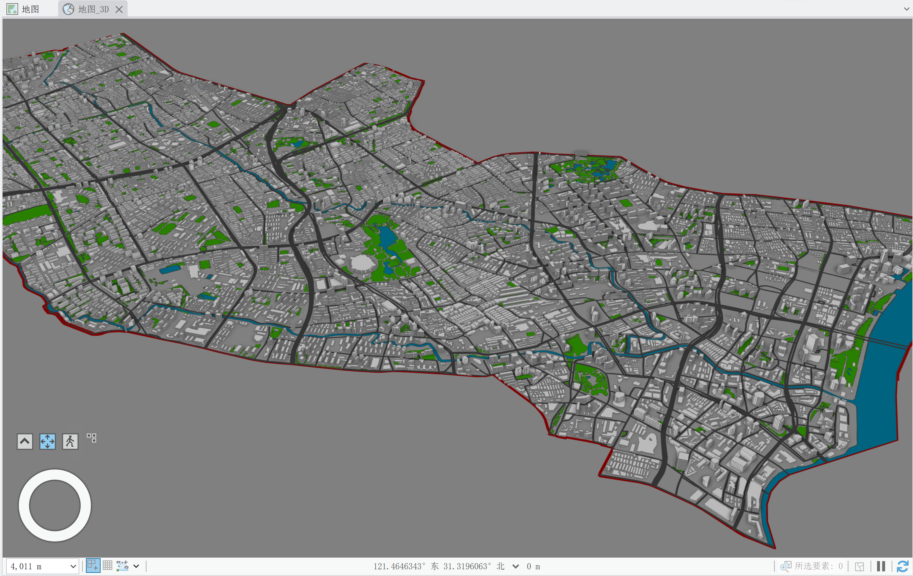
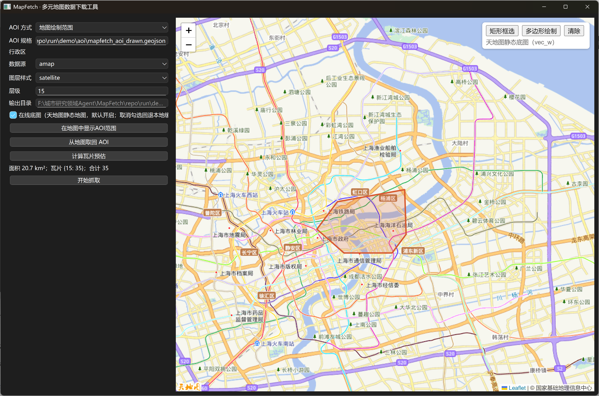

# MapFetch · 多元地图数据下载工具

从天地图、高德地图、百度地图等在线地图服务下载指定区域的**地图瓦片**（影像 / 街道底图，支持多缩放层级、拼接与导出）与**基础地理矢量要素**（道路网络、建筑图底、绿地、河流湖泊），统一转换为通用 GIS 格式（GeoTIFF / GeoPackage），供 ArcGIS / QGIS 直接使用。

---








## 特性

- **三种数据源**：天地图（默认，CGCS2000 直出、无加密偏移）/ 高德 / 百度；
- **四种区域选择**：行政区（省/市/区县）、矩形框选、多边形绘制、文件导入（GeoJSON / GeoPackage / Shapefile）；
- **双引擎架构**：
  - 引擎 A —— 瓦片直下（HTTP 异步并发，适合大范围影像/底图）；
  - 引擎 B —— JS API 渲染截图（Selenium + Firefox，可分离道路/建筑/背景要素）；
- **矢量要素生产**：栅格反演路径（二值化 → 骨架/面提取 → 矢量化 → 道路中心线抽稀拉直、建筑轮廓重构与正交化后处理）；
- **坐标系统一**：WGS84 / GCJ-02 / BD-09 互转，成果默认输出 **WGS84**，元数据全程可追溯；
- **负责任的抓取**：令牌桶限速 + 指数退避 + 日配额熔断 + 本地缓存断点续跑；
- **大区域友好**：GDAL VRT 流式拼接，大范围任务内存峰值控制在 500 MB 以内。

## 数据源能力一览

| 要素      | 天地图（默认）    | 高德            | 百度              | 实现路径          |
| ------- | ---------- | ------------- | --------------- | ------------- |
| 影像瓦片    | ✅ CGCS2000 | ✅             | ✅               | 引擎 A          |
| 街道底图    | ✅ CGCS2000 | ✅             | ✅               | 引擎 A          |
| 行政区边界   | ⚠️ 抽稀边界（备用） | ⚠️ REST API（备用） | ✅ BMap.Boundary | **DataV GeoAtlas**（默认，详细） |
| 道路网络    | —          | ⚠️ 仅栅格        | ⚠️ 仅栅格          | 引擎 B → 中心线矢量化 |
| 建筑图底    | —          | ⚠️ 仅栅格（z≥17）  | ⚠️ 仅栅格          | 引擎 B → 矢量化    |
| 绿地 / 水体 | —          | ⚠️ 仅栅格        | ⚠️ 仅栅格          | 引擎 B → 分类矢量化  |
| 建筑层数    | —          | ⚠️ 3D 遮挡法推断   | —               | 引擎 B（高级选项）    |

> 三源均**不提供**道路/建筑/绿地/水体的矢量数据下载接口，矢量要素采用栅格反演路径。本项目不使用 OpenStreetMap 数据源。

## 安装与运行

要求：Windows 10/11 x64，Python **3.11 / 3.12**；引擎 B 需 **Firefox 浏览器 + geckodriver 驱动**（geckodriver 放入系统 PATH 即可，非默认路径可用 `MAPFETCH_GECKODRIVER` 指定；Firefox 非默认路径用 `MAPFETCH_FIREFOX_BINARY`，详见 [引擎 B 配置](docs/engine-b-setup.md)）。

> ⚠️**注意**：本项目目前仅在 Windows 系统上测试，macOS 尚未测试。欢迎 macOS 用户测试并反馈；提交问题时请附上 macOS 版本、芯片类型、运行环境版本、复现步骤和报错日志/截图。成功运行也欢迎反馈，帮助完善兼容性说明。

**第 1 步：克隆仓库**

```bash
git clone https://github.com/Urbankernel/MapFetch mapfetch
cd mapfetch
```

**第 2 步：建环境并安装（二选一）**

```bash
# 方式一：conda（推荐，rasterio/geopandas 二进制依赖最稳）
conda env create -f environment.yml
conda activate mapfetch
pip install .   # 将 `mapfetch` 命令注册到当前环境

# 方式二：pip + venv
python -m venv .venv
.venv\Scripts\activate
pip install -r requirements.txt
pip install .
```

> 分发方式说明：本项目以**源码工具**形式分发，`pip install .` 安装即用；不提供 PyPI 包。`requirements.txt` / `requirements-dev.txt` 与 `environment.yml` 三者依赖保持同步。


**第 3 步：复制示例配置**

```bash
cp configs/example.yaml configs/config.yaml   # 任务配置（默认读取）
cp configs/keys.txt.example configs/keys.txt  # 密钥（已由 .gitignore 排除，不入库）
```

**第 4 步：运行**

```bash
mapfetch doctor     # 环境自检
mapfetch gui        # 启动 GUI
mapfetch fetch      # 默认读 configs/config.yaml，命令行同名参数可覆盖
```

### 配置 Key

复制示例并填写 `configs/keys.txt`（已被 .gitignore 排除）：

```text
tianditu=天地图tk        # 引擎 A 天地图瓦片、GUI 在线预览
amap_js=高德JS_API_Key    # 引擎 B 渲染（render/floors）
amap_rest=高德Web服务_Key  # 备用（行政区边界查询已改走 DataV GeoAtlas，见下）
amap_security=安全密钥     # 高德 JS API 2.0 安全密钥（自定义样式必需，见下）
amap_mapstyle=样式ID      # 高德自定义地图样式 ID（rd/water/green 的 mapStyle；免费版仅 1 个样式，ID 固定不变）
baidu=百度Key            # 引擎 A 百度瓦片
```

也支持环境变量方式（`env:` 前缀，如 `tianditu=env:MAPFETCH_TK_TIANDITU`）。各 Key 的申请地址、类型差异（高德 JS API 与 Web 服务**不可混用**）与解析顺序详见 [安装文档 §4](docs/installation.md)。

> **行政区边界查询（`aoi` 子命令与 `admin:` 规格）默认走阿里云 DataV GeoAtlas**。天地图行政区划 API（抽稀版）与高德 District API 保留为备用。

> **高德安全密钥（securityJsCode）**：2021-12 后申请的高德 Key，若要在引擎 B 中使用**自定义地图样式**（`amap_mapstyle`，配置于 `keys.txt`），必须同时填 `amap_security`，否则自定义样式不生效、回退默认样式。不填安全密钥时，官方预置样式（如 darkblue）仍可正常渲染。

## 快速上手（CLI）

**方式一：命令行直传参数**

```bash
# 行政区 + 天地图影像，z15–z17，输出 GeoTIFF（CGCS2000）
mapfetch fetch --aoi admin:310109 --source tianditu --style img_w --levels 15-17 --out run/demo/
```

**方式二：任务配置文件（推荐，参数多时更清晰）**

```bash
# 把参数写进 YAML，默认读 configs/config.yaml（fetch/render/floors/vectorize 四命令通用）
cp configs/example.yaml configs/config.yaml   # 复制示例后按需修改
mapfetch fetch                                # 默认读 configs/config.yaml

# 命令行同名参数可覆盖配置（如临时换层级）
mapfetch fetch --levels 15
```

任务配置YAML按 `common`（公共上下文）+ 各命令节（`fetch`/`render`/`floors`/`vectorize`）组织，字段与命令行参数一一对应，完整示例见 [`configs/example.yaml`](configs/example.yaml)。
四个数据命令均支持 `-c`，优先级为「命令行 > 命令节 > `common` 节 > 内置默认」，详见[使用指南 §2.3](docs/usage-guide.md#23-任务配置文件-c--config)。

**其余命令示例**

```bash
# 引擎 B：高德建筑图底渲染（要素分离，--reclassify 启用 §1.5 重分类）
mapfetch render --aoi "rect:121.520, 31.260, 121.545, 31.280" --template bld --zoom 17 --reclassify --out run/demo/

# 建筑层数扫描（3D 遮挡法，固定 z17）
mapfetch floors --aoi "rect:121.520, 31.260, 121.545, 31.280" --floor-min 0 --floor-max 36 --floor-step 3 --out run/demo/

# 栅格 → 矢量（road/building/water/green/floors → GPKG/SHP/GeoJSON）
mapfetch vectorize --input run/demo/raster/render_bld_z17/demo_bld_0_0_bin.png --kind building --out run/demo/vector/export/demo_buildings.gpkg

# 行政区边界落 GeoPackage（DataV GeoAtlas 详细边界，无需 Key）；环境自检
mapfetch aoi --name 上海市浦东新区 --out run/demo/aoi/pudong.gpkg
mapfetch doctor
```

> 以上命令覆盖「行政区边界 → 影像/底图瓦片 → 要素渲染 → 矢量化」完整链路。

> GUI（`mapfetch gui`）：PySide6 主界面 + QtWebEngine/Leaflet 交互式区域选择（行政区 / 矩形框选 / 多边形绘制），瓦片预估与一键抓取；打开即默认加载天地图**静态地图服务**（单张整图、加载快，初始定位上海市人民广场），可取消勾选回退本地缓存预览，底图失败自动降级为影像底图。

## 输出物

```
run/{name}/
├── manifest.json          # 任务元数据：来源/层级/坐标系/配额消耗/告警
├── README.md              # 自动生成：精度声明与使用限制
├── ATTRIBUTION.txt        # 数据来源署名（合规必备）
├── aoi/aoi.gpkg           # AOI 边界（GeoPackage，CGCS2000/EPSG:4490）
├── raster/{source}_{style}_z{n}/export/*.tif   # GeoTIFF（默认 CGCS2000；含完整版 + 按 AOI 裁剪版 _aoi.tif）
├── vector/export/*.gpkg                        # GeoPackage
└── logs/
```

## 文档

| 文档                                | 内容                                        |
| --------------------------------- | ----------------------------------------- |
| [安装](docs/installation.md)        | 环境要求、依赖、Key 申请与配置                         |
| [使用指南](docs/usage-guide.md)      | CLI 命令参考：按引擎/功能分章节，含参数表与完整示例              |
| [配置](docs/configuration.md)       | sources.yaml / limits.yaml / keys.txt 规格 |
| [引擎 B 配置](docs/engine-b-setup.md) | Firefox + geckodriver 安装、非默认路径环境变量、安全密钥       |


## 许可证

本项目代码采用 [MIT 许可证](LICENSE)。数据本身的许可归各数据源方所有。
